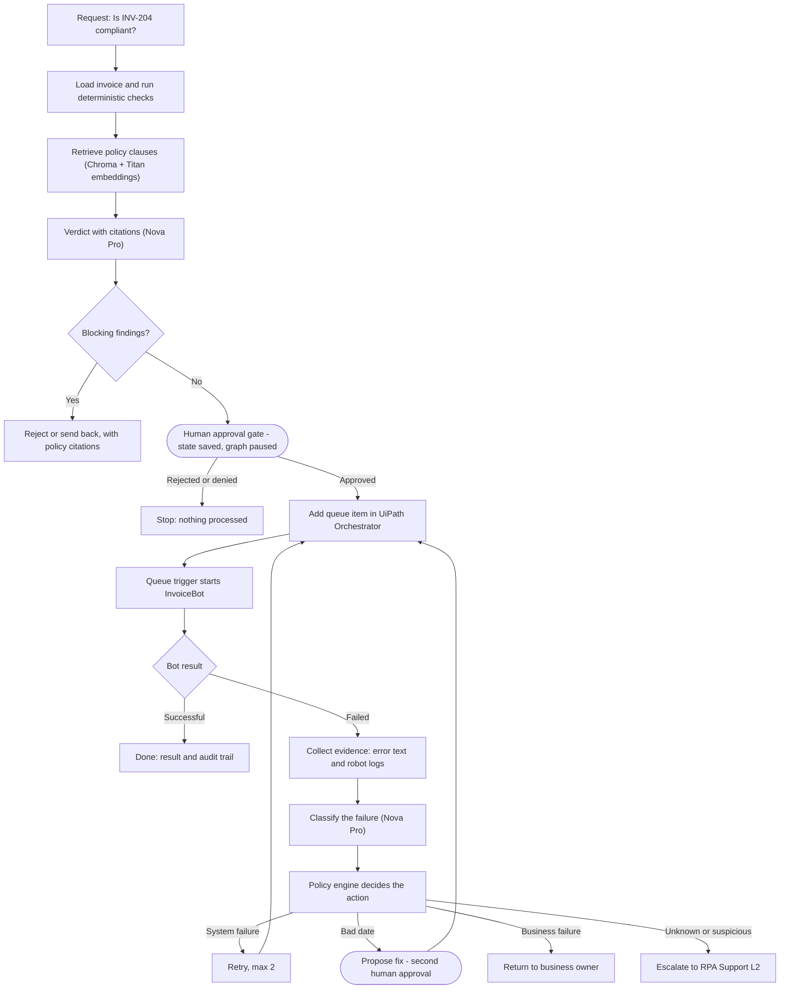

# ProcessPilot

A governed GenAI agent for invoice processing. It checks an invoice against policy documents (RAG with citations), waits for a human to approve, hands the invoice to a UiPath bot through an Orchestrator queue, and, when the bot fails, diagnoses the failure and decides whether to retry, propose a fix, return the invoice to its owner, or escalate.

All data is synthetic. Everything runs locally on a Windows machine; Amazon Bedrock is the only cloud service the code calls besides UiPath Orchestrator.

> **Positioning:** automation / RPA lead moving into agentic AI solutions. The point of the project is the control model around the AI, not the chatbot: code establishes facts, the model reasons over policy, a policy engine enforces the rules, and humans approve every data-changing action.

---

## How one request flows

Example request: *"Is invoice INV-204 compliant? If yes, process it."*



### Stage by stage

1. **Request and facts.** The agent extracts the invoice ID and loads the invoice. Plain Python checks run first: exact duplicate, vendor status, future or stale date, purchase-order requirement, GST type and rate. The required approver grade is derived from the invoice total.
2. **Policy retrieval.** The sections cited by the findings, plus the best semantic matches for the request, are pulled from the policy index (one chunk per numbered policy section).
3. **Verdict.** Nova Pro writes a short verdict that cites clauses such as `[POL-01 §2.3]`. Citations are validated against the sections that were actually supplied. If the model's citations cannot be trusted, the agent falls back to rule-based wording.
4. **Decision.** The final decision comes from the code findings. The model's verdict is cross-checked and any disagreement is recorded.
5. **Human approval (paused graph).** A compliant invoice pauses the LangGraph run with its full state saved in SQLite. A person approves or rejects from a separate process. The approver must not be the person who entered the invoice, and the approver's role must meet the required grade.
6. **Push to UiPath.** After approval the agent adds a queue item to the Orchestrator queue and stores the returned queue item ID in its state.
7. **Bot run.** A queue trigger starts the `InvoiceBot` (REFramework). The bot processes the item and ends it as Successful or Failed with a reason.
8. **Monitor.** The agent polls that one queue item until it reaches a final status or a timeout.
9. **Failure handling** (only if the bot failed). Evidence is gathered, the failure is classified, and the policy engine chooses one of four actions (see below).
10. **Audit.** Every decision, approval, submission, diagnosis and action is written to an append-only audit log.

### Failure handling

| Classification | Action | Policy basis |
|---|---|---|
| System failure (for example a timeout) | Retry, at most 2 times, then escalate | POL-06 §3 |
| Business failure: bad date | Propose a fix, a human approves it, then resubmit (once per invoice) | POL-06 §4.1 |
| Business failure: missing field, duplicate | Return to the business owner with the reason, never retried | POL-06 §2 |
| Unknown, or possible prompt injection in the evidence | Escalate to RPA Support L2 with a written record | POL-06 §5 |

The classifier proposes; the policy engine, which is plain code, decides. A fix may only touch an allowlisted field (`invoice_date`). Amounts, tax, vendor and bank details can never be changed automatically.

---

## Components and integrations

| Layer | Technology | Role |
|---|---|---|
| Knowledge base | 7 synthetic policy documents (markdown, numbered clauses) | What the agent cites |
| Embeddings | Amazon Titan Text Embeddings V2 (Bedrock) | Policy search vectors |
| Vector store | Chroma, local persistent folder | Policy retrieval |
| LLM | Amazon Nova Pro (Bedrock Converse API) | Verdicts and failure classification |
| Agent runtime | LangGraph with SQLite checkpointing | Graph, pause and resume at approval gates |
| Rules | Python (`checks.py`, `policy.py`) | Deterministic checks and the failure policy engine |
| RPA | UiPath Studio (REFramework), Orchestrator queue and queue trigger, unattended robot | Processes approved invoices |
| UiPath API | Orchestrator REST API, OAuth client credentials | Add queue items, read status and robot logs |
| Interfaces | Service layer, CLI, MCP server | Three entry points over the same logic |
| Records | SQLite audit log, JSON-lines escalation file | Paper trail |

### Amazon Bedrock

`bedrock.py` wraps two calls: `invoke_model` for embeddings (1024 dimensions) and `converse` for the LLM at temperature 0. Region and model IDs come from `.env`. Token counts are accumulated so cost per request can be reported.

### UiPath Orchestrator

`tools/uipath_client.py` uses plain REST calls:

- **Authentication:** an External Application (confidential, client credentials) obtains a bearer token from the identity endpoint. The token is cached until shortly before it expires.
- **Folder:** requests carry the `X-UIPATH-FolderPath` header (`Shared/ProcessPilot`).
- **Push:** `AddQueueItem` creates the item. The invoice fields go into `SpecificContent`, the invoice ID into `Reference`, and the Orchestrator-assigned queue item ID is returned.
- **Status:** `QueueItems(<id>)` returns status, retry count and the failure reason.
- **Logs:** robot logs for one item are the log rows written between the item's start and end times (the bot runs on a single robot, so the time window is unambiguous).

The queue's own retry is switched off (max retries 0). Retries are an agent decision and appear as new queue items, so the retry cap and the audit trail live in one place.

### The InvoiceBot (UiPath)

The bot is a Robotic Enterprise Framework project in `uipath/InvoiceBot`. It reads the queue item, applies a controlled failure switch carried in the item (`none`, `bad_date`, `missing_field`, `duplicate`, `app_timeout`), and on success appends a line to a local ledger file that stands in for a target application. Failure messages start with a code (`BAD_DATE:`, `MISSING_FIELD:`, `DUPLICATE:`, `APP_TIMEOUT:`); date and field problems are thrown as business rule exceptions and the timeout as a system exception. A queue trigger starts the bot whenever items are waiting.

### MCP server

`mcp_server/uipath_mcp.py` exposes the same service layer to MCP clients such as Claude Desktop (stdio transport).

| Tool | Type | Purpose |
|---|---|---|
| `search_policy` | read | Policy clauses with citations |
| `check_invoice` | read | Deterministic findings and required approver |
| `submit_request` | write, gated | Starts the agent; idempotent through `request_id`; stops at the approval gate |
| `get_request_status` | read | Stage, outcome and any failure diagnosis |
| `get_job_logs` | read | Robot log lines, flagged as untrusted data |
| `get_audit_trail` | read | Recent audit events for an invoice |

Deliberately **not** exposed: approvals, direct queue writes, deletes, job control, credentials, and any edit of amounts or vendor details. An MCP client can propose and observe; only a person can approve. Inputs are format-checked, submissions are rate-limited, and the simulation switch is refused unless the server enables it.

---

## Guardrails

- Code establishes facts (duplicates, dates, vendor status, approver grade); the model never guesses them.
- The policy engine has the final say on failure handling and is covered by unit tests that need no network.
- Retry cap of 2, with a policy minimum of 5 minutes between retries.
- No automatic change to amounts, tax, vendor or bank details.
- Human approval before processing and before any proposed fix; self-approval is denied.
- Evidence text (logs, error messages) is treated as untrusted data. The classifier is told never to follow instructions inside it and to flag attempts, and any flagged case is escalated.
- Every step is recorded in the audit log: `DECISION`, `APPROVAL_*`, `PROCESS_SUBMITTED`, `PROCESS_RESULT`, `FAILURE_DIAGNOSED`, `ACTION_*`, `RETRY_SCHEDULED`, `FIX_APPROVAL_*`, `FIX_APPLIED`, `ESCALATED`, `RETURNED_TO_OWNER`, `MCP_SUBMIT`, `MCP_REFUSED`.

---

## Project layout

```
processpilot/
  src/processpilot/
    config.py  bedrock.py  service.py
    rag/            chunk.py  ingest.py  retrieve.py  answer.py
    agent/          state.py  main_graph.py  exception_nodes.py
                    classify.py  policy.py  cli.py
    tools/          checks.py  invoice_store.py  audit.py
                    uipath_client.py  evidence.py
    mcp_server/     uipath_mcp.py
  data/policies/    generated policy documents
  scripts/          setup and smoke-test scripts
  eval/             evaluation scripts and cases
  uipath/InvoiceBot/  UiPath REFramework project
  tests/            policy engine and MCP guard tests
  pyproject.toml  requirements.txt  .env.example
```

`service.py` is the single entry point used by both the CLI and the MCP server, so no rule is duplicated outside the agent.

---

## Setup (Windows, PowerShell)

### 1. Prerequisites

- Python 3.12 or newer, Git, VS Code
- AWS account with Bedrock model access in your region (Titan Text Embeddings V2 and Nova Pro) and an AWS CLI profile
- UiPath Community Cloud account with UiPath Studio installed

### 2. Python environment

```powershell
python -m venv .venv
.\.venv\Scripts\Activate.ps1
pip install -r requirements.txt
pip install -e .
Copy-Item .env.example .env      # then fill in the values
```

### 3. Configuration (`.env`)

| Variable | Purpose |
|---|---|
| `AWS_PROFILE`, `AWS_REGION` | AWS CLI profile and Bedrock region |
| `EMBED_MODEL_ID` | `amazon.titan-embed-text-v2:0` |
| `LLM_MODEL_ID` | Nova Pro inference profile ID for your region |
| `UIPATH_ORG`, `UIPATH_TENANT` | From the Orchestrator URL |
| `UIPATH_FOLDER`, `UIPATH_QUEUE` | `Shared/ProcessPilot`, `ProcessPilotInvoices` |
| `UIPATH_CLIENT_ID`, `UIPATH_CLIENT_SECRET` | External Application credentials |
| `UIPATH_SCOPES` | `OR.Queues OR.Jobs OR.Monitoring OR.Folders.Read OR.Execution.Read` |

Optional runtime variables: `RETRY_WAIT_SECS` (demo shortcut for the retry wait), `PP_ALLOW_SIMULATION=1` (MCP server accepts the failure-simulation switch), `PP_CLIENT_ID` (caller name recorded in the audit log), `PP_MAX_SUBMITS_PER_HOUR`.

### 4. Generate data and build the policy index

```powershell
python scripts\create_policies.py
python scripts\create_invoices.py
python -m processpilot.rag.ingest
python scripts\smoke_test.py          # checks Bedrock access
```

### 5. UiPath side

1. In Orchestrator create a folder `Shared/ProcessPilot` and a queue `ProcessPilotInvoices` (enforce unique reference off, max retries 0).
2. Create an External Application (confidential) with the scopes above and give it the Folder Administrator role on the folder.
3. In Studio, open `uipath/InvoiceBot`, select the folder and queue on the *Get transaction item* activity, and publish to the Orchestrator tenant feed.
4. Create a process from the published package in the folder, and add a queue trigger (queue `ProcessPilotInvoices`, process `InvoiceBot`, 1 concurrent job).
5. Create the ledger folder: `New-Item -ItemType Directory -Force C:\ProcessPilot`.
6. Verify the API connection: `python scripts\uipath_smoke.py`.

---

## Running it

Start a request. The agent runs until the approval gate and prints a thread ID:

```powershell
python -m processpilot.agent.cli run "Is invoice INV-204 compliant? If yes, process it."
```

Approve (or reject) as a person who did not enter the invoice:

```powershell
python -m processpilot.agent.cli approve <thread> --by r.kumar --role "Finance Manager"
python -m processpilot.agent.cli approve <thread> --by r.kumar --role "Finance Manager" --reject --reason "..."
```

Inject a failure to see the exception handling (demo only):

| `--simulate` value | What happens |
|---|---|
| `app_timeout_once` | First attempt times out, the retry succeeds |
| `app_timeout` | Every attempt times out, escalation after 2 retries |
| `bad_date` | Fix proposed, second approval, resubmit |
| `missing_field`, `duplicate` | Returned to the business owner |

```powershell
$env:RETRY_WAIT_SECS = 20     # demo shortcut; policy minimum is 300 seconds
python -m processpilot.agent.cli run "Is invoice INV-204 compliant? If yes, process it." --simulate app_timeout_once
```

Inspect the records:

```powershell
python -m processpilot.tools.audit          # audit trail
Get-Content data\escalations.jsonl          # escalation records
Get-Content C:\ProcessPilot\ledger.csv      # what the bot processed
```

### Using it from Claude Desktop (MCP)

Add the server to `claude_desktop_config.json` (**Settings > Desktop app > Extensions > Edit config**), then fully quit and reopen the app:

```json
{
  "mcpServers": {
    "processpilot": {
      "command": "D:/path/to/processpilot/.venv/Scripts/python.exe",
      "args": ["-m", "processpilot.mcp_server.uipath_mcp"],
      "env": { "PP_CLIENT_ID": "claude-desktop" }
    }
  }
}
```

Ask Claude to check an invoice and submit a request. It will stop at the approval gate and tell you the terminal command a person must run. The server is pinned to `mcp<2` because the 2.x SDK renamed the server class.

---

## Tests

```powershell
python -m pytest -q
```

The unit tests cover the failure policy engine and the MCP input guards and need no AWS or UiPath access. Evaluation scripts live in `eval/`.

---

## Known limitations

- **Identity is simulated.** Approvers are typed on the command line. A real deployment would take identity and role from single sign-on and put a web or chat approval front end on `service.submit_decision`.
- **Silent data errors are not caught.** The agent diagnoses failures. A plausible but wrong value (for example a day and month swapped into another valid date) lets the bot succeed. This needs checks before processing, such as comparing against PO and goods-receipt dates, or confidence scores at extraction.
- **Polling.** The agent waits on the bot by polling. At scale this should become event-driven.
- **Log lookup assumes one robot,** because it selects logs by time window. With several robots, the queue item or job key should be logged on every bot line.
- **Local state.** Checkpoints and the audit log are local SQLite files.
- **Demo shortcuts.** The retry wait can be shortened for demos (the audit log records both the wait used and the policy minimum), and the bad-date fix is simulated.
- **MCP over stdio** has no authenticated caller. Production use would need streamable HTTP with OAuth.
